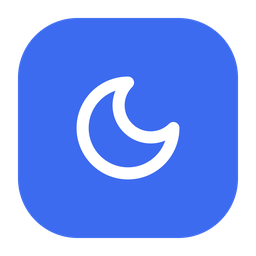
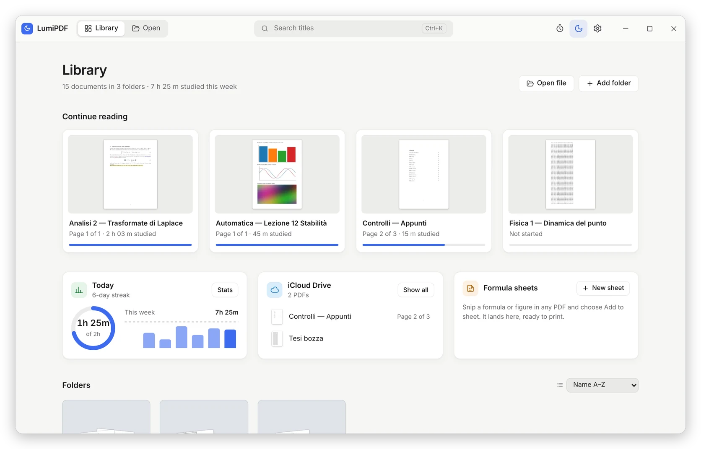
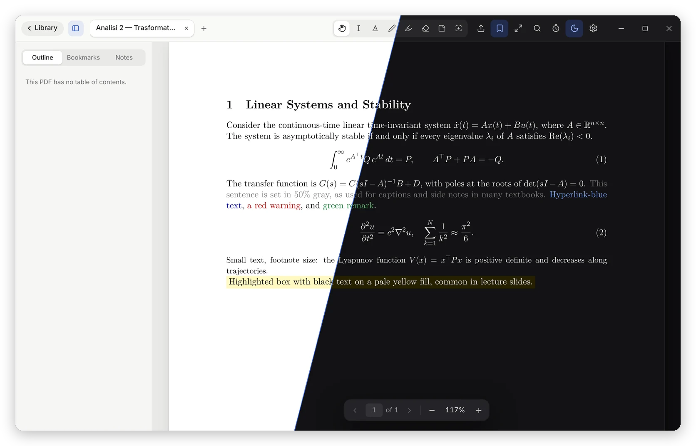
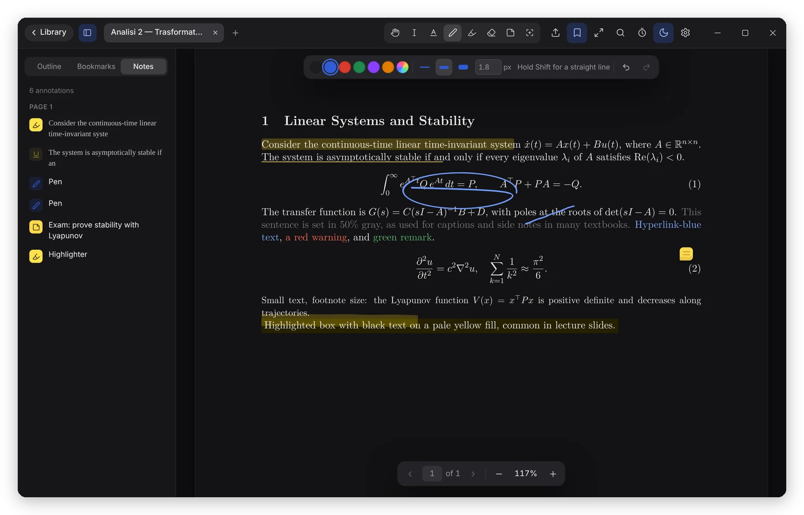
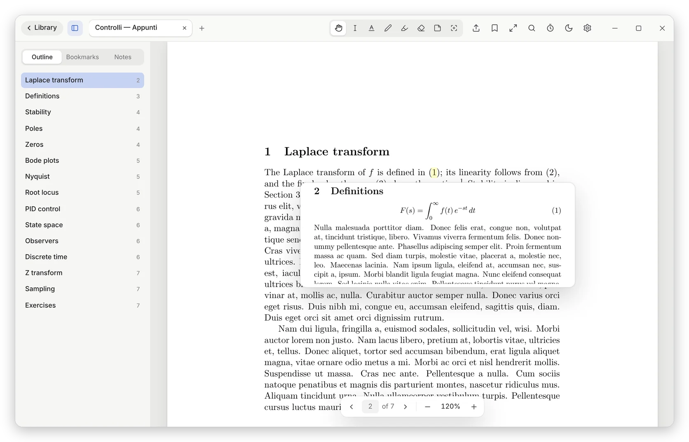
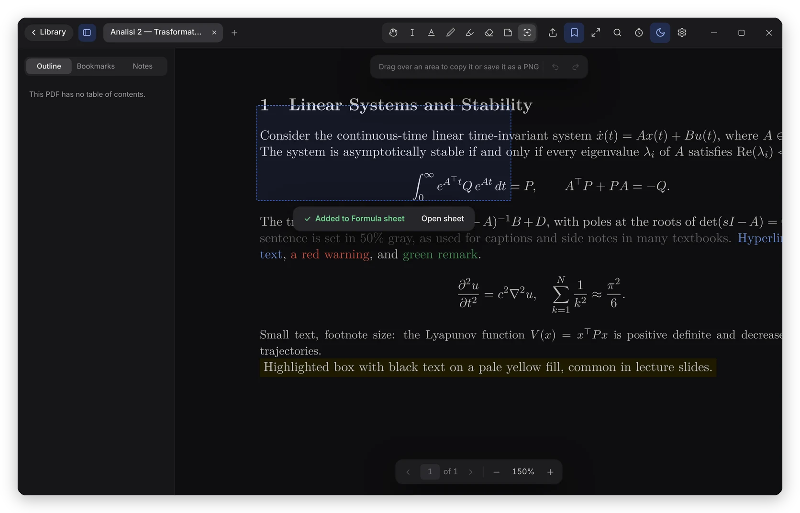
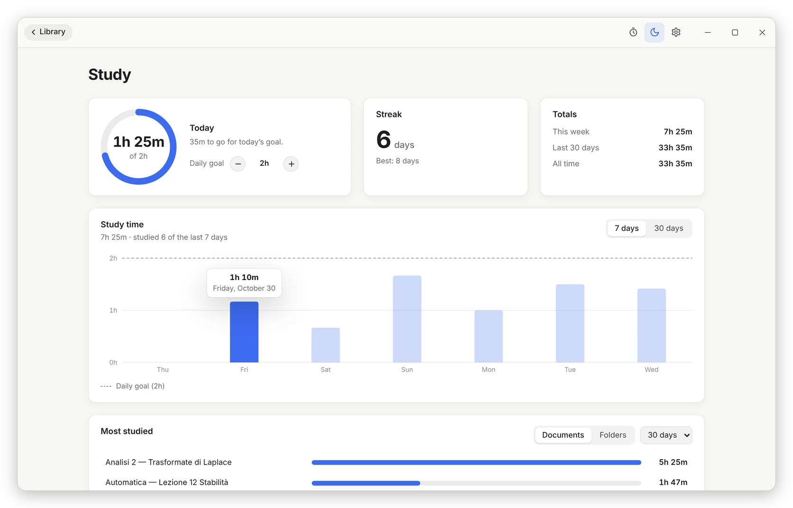
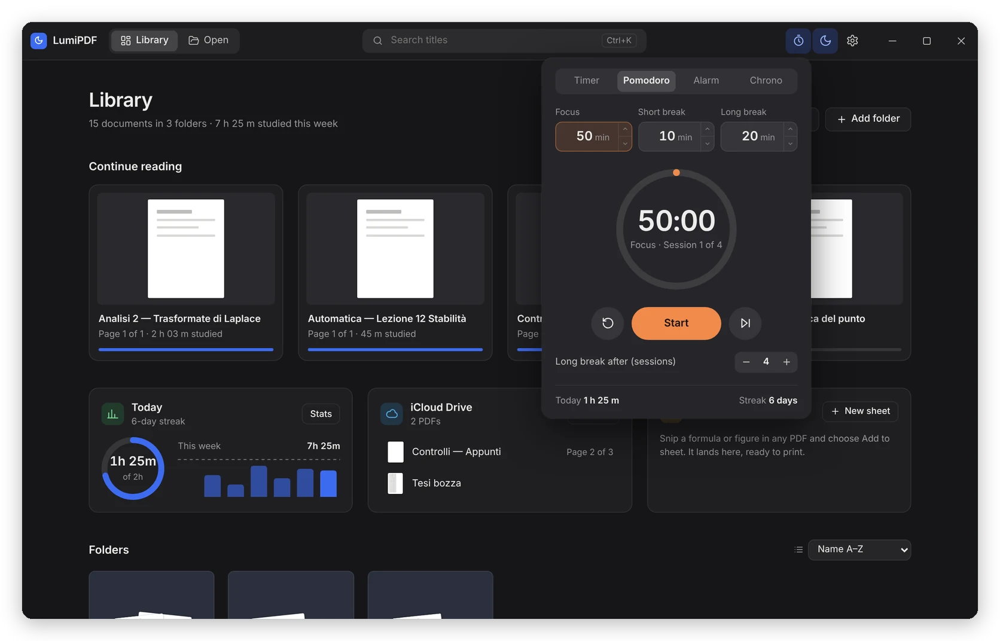
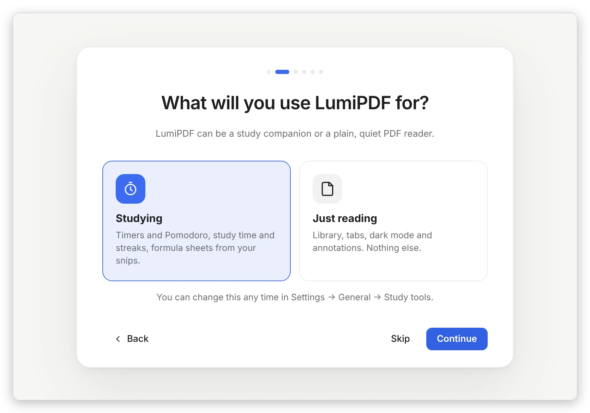

# LumiPDF

**The PDF reader for long study nights.** 
A real dark mode that keeps every formula sharp, your notes on the page, and everything you need to study, in one light, free app.

 

<picture>
  <source media="(prefers-color-scheme: dark)" srcset="docs/images/library-dark.webp" />
  
</picture>

## Why LumiPDF?

Most PDF readers make "dark mode" by inverting the whole page. Text gets blurry, diagrams turn
into negatives and coloured highlights become strange colours. LumiPDF is built for people who read
PDFs for hours: lecture notes, textbooks, papers, slides.

- 🌙 **Dark mode done right.** Pages are recoloured while they're drawn, so text and maths stay as sharp as the original.
- ✏️ **Write on your PDFs.** Highlight, draw and add notes; your original file is never touched.
- 🔗 **Peek at links.** Hover "see equation (3)" and the equation appears right there.
- ⏱️ **Study tools built in.** Timer, Pomodoro, daily goal, streaks and formula sheets, or turn them all off.
- 🔒 **Private.** No account, no cloud, no tracking. Your files never leave your computer.
- 💸 **Free and open source.** Forever.

## A dark mode that doesn't blur

Switch with one click (or <kbd>Ctrl</kbd>+<kbd>Shift</kbd>+<kbd>D</kbd>). Choose between five
reading themes, set brightness, contrast and text weight, and let LumiPDF switch by itself at
night or follow Windows. Photos and coloured diagrams stay recognisable instead of turning into
negatives.

## Your notes, on the page

Highlight, underline or strike text. Draw with a pen or a highlighter in any colour. Add sticky
notes and comments. Everything is listed in the **Notes** panel, so you can jump back to it later.
Undo and redo work as you'd expect.

Your notes are saved next to the app, never inside your PDF. When you want to share them,
**export a copy** with your annotations as real PDF annotations that open in any other reader.

## See what a link points to, without losing your place

Textbooks are full of "see Figure 4", "by Theorem 2.1" and footnotes. Hover the link and LumiPDF
shows you that spot of the document in a small preview. No more jumping back and forth.

## Snip anything into a formula sheet

Drag over a formula, a table or a figure and copy it, save it as a picture, or add it to a
**formula sheet**. LumiPDF arranges your snips on A4 or Letter pages (or lets you place them
freely) and exports a sheet that's ready to print for your exam.

## Study time that counts

<table>
  <tr>
    <td width="50%"></td>
    <td width="50%"></td>
  </tr>
</table>

LumiPDF counts the time you actually spend reading. Set a daily goal, keep a streak, and see which
subjects and documents take most of your week. A timer, a Pomodoro, an alarm and a stopwatch are
one click (or <kbd>Ctrl</kbd>+<kbd>Shift</kbd>+<kbd>T</kbd>) away.

## Just want to read? That's fine too

The first time you open LumiPDF, choose **Studying** or **Just reading**. With *Just reading* the
timers, stats and sheets disappear and you get a clean, quiet PDF reader. You can change your mind
any time in Settings.

## And everything else you'd expect

- 📚 **A library** that shows what you were reading, your folders (sorted A–Z, Z–A or by last opened), and PDFs in iCloud Drive, OneDrive, Google Drive and Dropbox, plus GoodNotes backups if you use them.
- 🗂️ **Tabs** for many documents at once. Tabs in the background rest to keep your computer fast, and come back on the same page.
- 📤 **Export a copy** with your notes, optionally smaller, with its password kept. Protection can be removed from the copy only if you know the password.
- ✋ **Hand tool** to drag pages around, **full screen** with <kbd>F11</kbd>, bookmarks, search and the document outline.
- 🌍 **Six languages**: English, Italiano, Português (Brasil), Français, Deutsch and Español. LumiPDF starts in your Windows language.
- 🔄 **Updates in the app**: automatic, or only when you say so.

<b>Keyboard shortcuts</b>

 

| Action | Keys |
| --- | --- |
| Open a PDF | <kbd>Ctrl</kbd>+<kbd>O</kbd> |
| Search the library | <kbd>Ctrl</kbd>+<kbd>K</kbd> |
| Find in the document | <kbd>Ctrl</kbd>+<kbd>F</kbd> |
| Dark mode on or off | <kbd>Ctrl</kbd>+<kbd>Shift</kbd>+<kbd>D</kbd> |
| Bookmark the page | <kbd>Ctrl</kbd>+<kbd>D</kbd> |
| Zoom in / out / fit width | <kbd>Ctrl</kbd>+<kbd>=</kbd> / <kbd>Ctrl</kbd>+<kbd>-</kbd> / <kbd>Ctrl</kbd>+<kbd>0</kbd> |
| Next / previous tab | <kbd>Ctrl</kbd>+<kbd>Tab</kbd> / <kbd>Ctrl</kbd>+<kbd>Shift</kbd>+<kbd>Tab</kbd> |
| Close the tab | <kbd>Ctrl</kbd>+<kbd>W</kbd> |
| Export a copy | <kbd>Ctrl</kbd>+<kbd>E</kbd> |
| Start or pause the timer | <kbd>Ctrl</kbd>+<kbd>Shift</kbd>+<kbd>T</kbd> |
| Full screen | <kbd>F11</kbd> |
| Settings | <kbd>Ctrl</kbd>+<kbd>,</kbd> |
| Tools: hand, select, highlight, pen, highlighter, eraser, note, snip | <kbd>G</kbd> <kbd>V</kbd> <kbd>H</kbd> <kbd>P</kbd> <kbd>M</kbd> <kbd>E</kbd> <kbd>N</kbd> <kbd>S</kbd> |

## Download

1. Go to the [latest release](https://github.com/hydese/LumiPDF/releases/latest) and download
   **`LumiPDF_…_x64-setup.exe`**.
2. Open it. Windows may say **"Windows protected your PC"** because the installer isn't
   code-signed yet: click **More info → Run anyway**.
3. That's it. LumiPDF keeps itself up to date from now on.

Each release lists the installer's SHA-256 checksum, so you can check your download is the real one
(in PowerShell: `Get-FileHash .\LumiPDF_…_x64-setup.exe`).

Works on Windows 10 and 11.

**Mac:** LumiPDF for Apple Silicon Macs (macOS 13 or later) arrives with version 2.1.0, as a
`.dmg` on the [Releases page](https://github.com/hydese/LumiPDF/releases): open it and drag LumiPDF
into Applications. LumiPDF isn't signed by Apple, so the first time macOS says it can't verify it:
click **Done**, then go to **System Settings → Privacy & Security**, scroll down and click
**Open Anyway**.

## Questions

<b>Is it really free?</b>

 
Yes. No ads, no subscription, no account. LumiPDF is open source under the GNU GPL v3: anyone can
read and change the code, and anyone who shares a changed version must share its code too.

<b>Does it change my PDFs?</b>

 
Never. Your notes are stored separately and only go into a PDF when you export a new copy. The
original file is never overwritten.

<b>Does it send my data anywhere?</b>

 
No. The only time LumiPDF goes online is to check GitHub for a new version, and you can turn that
off in Settings.

<b>Why does Windows warn me when I install it?</b>

 
Windows trusts installers signed with a code signing certificate, and LumiPDF doesn't have one yet
(see <a href="CODE_SIGNING.md">CODE_SIGNING.md</a>). Updates installed from inside the app are
always checked against LumiPDF's own signature, so they can't be tampered with.

<b>Can I open password-protected PDFs?</b>

 
Yes, with their password. LumiPDF respects the protection: printing or copying that the author
blocked stays blocked, and protection can only be removed from a copy if you know the password.

## Found a bug or have an idea?

[Open an issue](https://github.com/hydese/LumiPDF/issues). Screenshots help a lot.

Want to build LumiPDF yourself or help with the code? Start from
[docs/DEVELOPMENT.md](docs/DEVELOPMENT.md). Looking for LuminaPDF 1.x? It's on the
[`v1` branch](https://github.com/hydese/LumiPDF/tree/v1).

## License

[GNU General Public License v3.0 or later](LICENSE) © hydese

LumiPDF 2.0 and later are GPL. Earlier releases (1.x and the 2.0 betas before 2.0.0-beta.2) were
published under the MIT License.
